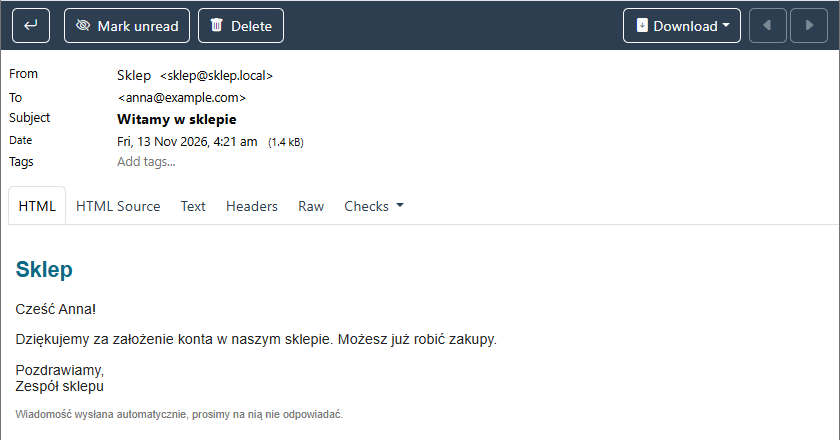
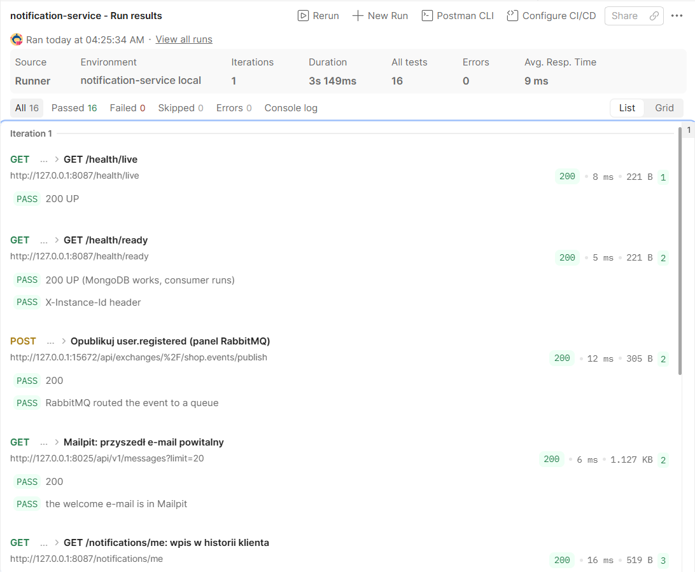

# Weryfikacja Notification Service — 13 listopada 2026

Sprawdzenie na laptopie z Windows 11 (Docker Desktop), przy wspólnej infrastrukturze z `deploy/compose.yaml` (RabbitMQ, MongoDB, Mailpit, Consul). Usługa uruchomiona z terminala (`python -m app`), tak jak z VS Code (patterns.md, sekcja 1).

## Wyniki

| Co | Wynik |
|---|---|
| pytest (atrapy RabbitMQ, MongoDB, SMTP i User Service) | **19 testów, wszystkie przeszły** |
| Start: rejestracja w Consulu, połączenie z MongoDB i `notification.q` | `Registered in Consul`, `Consumer started` |
| Zdarzenie `user.registered` opublikowane z panelu RabbitMQ | e-mail „Witamy w sklepie” w Mailpit (zrzut niżej) |
| Kolekcja Postman `postman/notification-service.postman_collection.json` | **8 żądań, 16 testów, 0 błędów** (zrzut niżej) |
| Wysyłka przez SMTP z polskimi znakami (lokalny serwer SMTP) | temat, część tekstowa i HTML poprawne; imię z `<b>` zostaje tekstem |
| Start bez MongoDB i bez RabbitMQ | usługa działa, ponawia połączenia (1, 2, 4 … 30 s), `/health/ready` 503, `/health/live` 200 |

Kolekcja Postman wysyła testowe zdarzenie przez HTTP API RabbitMQ, a potem sprawdza e-mail w Mailpit (`/api/v1/messages`) i wpis w `GET /notifications/me`.

## Sprawdzone zasady

| Zasada | Jak sprawdzono |
|---|---|
| D19 / events.md: kolejka otwierana pasywnie, `prefetch` 10, ręczny `ack` | kod `app/consumer.py`; działa z kontem `notification-service`, które nie może deklarować kolejek |
| D19: `type` równy kluczowi routingu, znana `version`, poprawna koperta i `payload` | 9 rodzajów złych wiadomości → od razu `nack(requeue=False)` (pytest) |
| D19: nigdy `requeue=True` | atrapa wiadomości przerywa test przy `requeue=True` (pytest) |
| events.md, zasada 4: 3 próby (5 s, 30 s), potem DLQ | User Service zwraca 503 → 3 próby odbiorcy, każda z 3 wywołaniami HTTP (D2), potem `nack` (pytest) |
| Idempotencja w Notification | ten sam `eventId` dwa razy → jeden e-mail; wyścig dwóch instancji → unikalny indeks, `ack`; błąd bazy po wysłaniu → bez ponownej wysyłki (pytest) |
| events.md, „Czego nie robić”: escapowanie danych klienta | imię `<a href=…>` w HTML jako tekst; temat bez danych klienta (pytest) |
| D2 wywołanie User Service | timeout 2 s, ponowienia po 502/503/504, 404 = brak profilu → `ack` bez e-maila (pytest) |
| D11 / events.md, zasada 9: nagłówki wywołania z pracy w tle | `X-User-Roles: SERVICE`, `X-User-Id` = `userId`, `X-Request-Id` = `requestId` zdarzenia (pytest) |
| D7, D11 API | `GET /notifications/me` bez logowania → 401, tylko własne wpisy, zły `X-User-Id` → 400 (pytest, Postman) |
| D13, D14, D15, D16, D17 | rejestracja i wyrejestrowanie w Consulu, KV (`logLevel`, `mail.from`), gotowość = MongoDB i działający odbiorca, logi JSON z `eventId` bez adresów e-mail, zatrzymanie < 1 s (ręcznie) |

## Czego nie sprawdzono

- E-maili o zamówieniach i przesyłkach na prawdziwych usługach: Order i Shipping jeszcze nie istnieją, a User Service nie działa w Docker Compose. Logika tych e-maili jest sprawdzona w pytest z atrapą User Service. Zdarzenie `order.created` opublikowane z Postmana bez User Service trafia po 3 próbach do `notification.dlq` (zgodnie z events.md).
- Budowy obrazu Docker i uruchomienia w Docker Compose (wpis w `deploy/compose.yaml` dopisuje Michał po scaleniu PR).

## Poprawki po przeglądzie PR #12 (13 listopada 2026)

| Uwaga | Poprawka | Jak sprawdzono |
|---|---|---|
| Odbiorca „umierał” po cichu po usunięciu kolejki | co 15 s `get_queue(..., ensure=True)`; `ChannelNotFoundEntity` kończy zadanie, błędy połączenia są pomijane; `add_done_callback` zapisuje log `error` z przyczyną | pytest z atrapą RabbitMQ: usunięta kolejka → log `Event consumer stopped`, `/health/ready` 503; przerwa brokera przy sprawdzeniu nie kończy odbiorcy |
| `requestId` spoza ASCII psuł wywołanie User i otwierał wyłącznik | `eventId` musi być UUID (inaczej DLQ), zły `requestId` → nowy UUID | pytest: 4 dziwne `requestId` → e-mail wysłany, do User poszedł nowy UUID; 10 takich zdarzeń nie blokuje poprawnego zamówienia innego klienta |
| Ponowienia wracały jednocześnie; 400/401/403 ponawiane 3 razy | odstęp × `random.uniform(1, 1.5)`; 4xx poza 404, 408, 429 i odpowiedź niezgodna z kontraktem → `PermanentError`, od razu DLQ | pytest: rozrzut odstępów, jedno wywołanie User przy 400/401/403/422, 408 i 429 dalej ponawiane, trwałe odmowy nie otwierają wyłącznika |
| Wymagane pola, których e-maile nie używają | usunięte `items[].productId` i `shipmentId` z modeli (tabela w `docs/events.md`) | pytest: zdarzenia bez tych pól (albo z innym ich formatem) dają e-mail |
| Zawieszony Consul (ten sam kod co w Product) | jak w Product: jedno zapytanie dla równoczesnych żądań, porażka zapamiętana | pytest |
| Brak manifestów Kubernetes | `k8s/app.yaml`, `k8s/README.md` | `kubeconform -strict`, schemat Kubernetes 1.30: 2 zasoby poprawne; wdrożenia w klastrze nie wykonano |

pytest po poprawkach: **31 testów**, wszystkie przeszły. Nowe testy nie przechodzą na kodzie sprzed poprawek.
