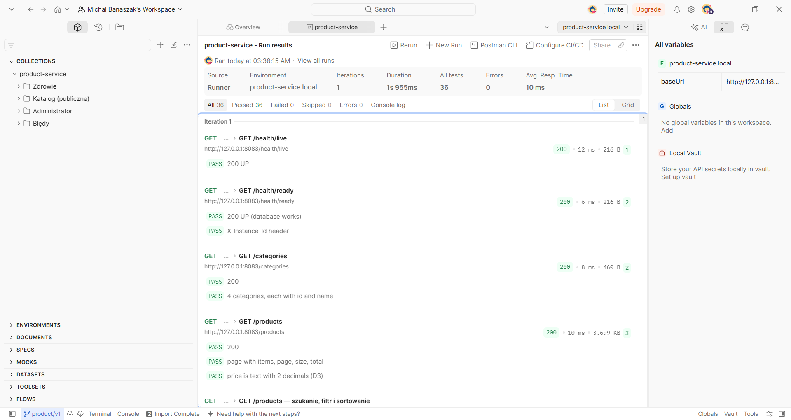

# Weryfikacja Product Service — 13 listopada 2026

Sprawdzenie na laptopie z Windows 11 (Docker Desktop), przy wspólnej infrastrukturze z `deploy/compose.yaml`. Usługa uruchomiona z terminala (`python -m app`), tak jak z VS Code (patterns.md, sekcja 1).

## Wyniki

| Co | Wynik |
|---|---|
| pytest (SQLite, migracje Alembic, atrapy Review i Inventory) | **33 testy, wszystkie przeszły** |
| pytest na PostgreSQL (`TEST_DATABASE_URL`) | 33 testy, wszystkie przeszły |
| Migracje `alembic upgrade head` na `product_db` (PostgreSQL 17 z compose) | tabele i dane startowe (4 kategorie, 24 produkty) |
| `/health/live`, `/health/ready` | 200 `{"status":"UP"}` |
| Rejestracja w Consulu (`SERVICE_ADDRESS=host.docker.internal`) | instancja `product-service-<hostname>`, check `/health/ready` **passing** |
| Kolekcja Postman `postman/product-service.postman_collection.json` (Runner, środowisko „product-service local”) | **17 żądań, 36 testów, 0 błędów** (zrzut niżej) |

## Sprawdzone zasady

| Zasada | Jak sprawdzono |
|---|---|
| D1 identyfikatory | zły UUID w ścieżce, w query i w treści → 400 `VALIDATION_ERROR` (pytest, Postman) |
| D2 wyłącznik i ponowienia | testy wyłącznika (otwarcie po 10 wywołaniach i 50 % awarii, jedno wywołanie próbne); brak połączenia z Review → 3 próby, 404 z Inventory → bez ponowień (pytest) |
| D3 kwoty | cena zawsze tekstem `"19.99"` z `currency`; cena jako liczba → 400 (pytest, Postman) |
| D4 lekki odczyt | z rolą `SERVICE` brak wywołań Review i Inventory; wycofany produkt → 404 (pytest, Postman) |
| D5 termin | wspólny termin 8 s na oba wywołania szczegółów produktu (kod `app/clients.py`) |
| D7 błędy | format `{"status","error","message","requestId"}` dla 400, 401, 403, 404, 405, 500 i 503 (baza niedostępna) (pytest, Postman) |
| D10, D11 tożsamość | bez `X-User-Id` → 401, bez `ADMIN` → 403, rola sprawdzana jako element listy (`XADMIN` → 403); przekazywanie `X-User-Id`, `X-User-Roles` z `SERVICE` i `X-Request-Id` dalej (pytest) |
| D12 ścieżki | `/products/` → 404 bez przekierowania; `HEAD` jak `GET` (pytest, Postman) |
| D13 Consul | rejestracja, start bez Consula z ponawianiem w tle, wyrejestrowanie przy zatrzymaniu (ręcznie) |
| D14 konfiguracja z KV | `logLevel` i `cacheTtlSeconds` z `config/product-service/data`; zmienna środowiskowa wygrywa (ręcznie) |
| D15 zdrowie | zatrzymana baza → `/health/ready` 503, `/health/live` 200 (pytest) |
| D16 logi | JSON na stdout z `requestId` i `userId`, bez haseł i danych osobowych (ręcznie) |
| D17 zamykanie | po SIGTERM zatrzymanie w ok. 2 s z wyrejestrowaniem z Consula (ręcznie, Linux) |
| Cache | zapis (`POST`, `PUT`, `DELETE`) czyści cache, kolejny odczyt widzi zmianę (pytest) |

## Czego nie sprawdzono

- Budowy i uruchomienia obrazu Docker w Docker Compose (wpis `product-migrate` i `product-service` w `deploy/compose.yaml` dopisuje Michał po scaleniu PR).
- Integracji z prawdziwymi Review i Inventory (jeszcze nie są w `develop`); zamiast nich atrapy w testach.
- Ruchu przez API Gateway i Kubernetesa.

Ostrzeżenie `StarletteDeprecationWarning` w pytest pochodzi z klienta testowego FastAPI i nie wpływa na wynik.
